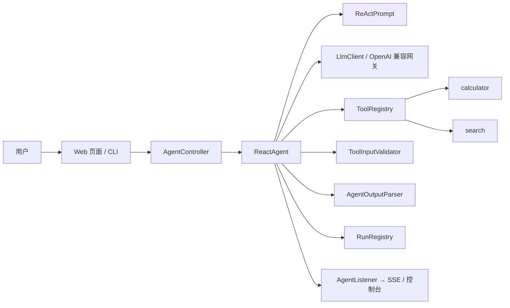

# ReAct Agent

一个**不依赖任何 Agent 框架**、纯手写的 ReAct（Reasoning + Acting）智能体示例项目。

项目用 Spring Boot 提供 Web/HTTP 入口，用一段简单的 `while` 循环驱动「思考 → 行动 → 观察」：
把问题和历史拼成消息发给 OpenAI 兼容模型，解析模型返回的 JSON 决策，执行对应工具，
再把工具结果写回上下文，直到模型给出最终答案、步数用尽、被取消或超时。

- 不引入 LangChain4j / Spring AI / AutoGen 等框架
- 模型调用只用 JDK `HttpClient` + Jackson 手写 OpenAI 兼容协议
- 工具注册、参数校验、输出解析、超时取消、流式输出全部自己实现
- 自带 Web 页面、SSE 流式接口、一次性 HTTP 接口和命令行入口

> 适合用来学习 ReAct 智能体的最小完整实现，也适合作为二次开发的起点。

---

## 目录

- [主要特性](#主要特性)
- [技术栈](#技术栈)
- [快速开始](#快速开始)
- [使用方式](#使用方式)
- [运行流程](#运行流程)
- [项目结构](#项目结构)
- [配置项](#配置项)
- [核心设计](#核心设计)
- [扩展指南](#扩展指南)
- [测试](#测试)
- [已知问题](#已知问题)
- [提交规范](#提交规范)

---

## 主要特性

| 能力 | 说明 |
| --- | --- |
| 手写 ReAct 循环 | 一个 `while` 循环完成「拼消息 → 问模型 → 解析 → 执行工具 → 回填观察」 |
| 通用输出协议 | 用一份 JSON Schema 约束 `action` / `final` 两种输出，不锁死工具名 |
| 结构化工具 | 工具带 JSON Schema，运行时由 `ToolInputValidator` 校验入参 |
| 自动纠错 | 模型输出不合 Schema 时，把校验错误反馈给模型重试（最多 2 次尝试） |
| 工具超时隔离 | 工具在独立线程池执行，超时只产生失败 Observation，不直接终止整次运行 |
| 运行级超时/取消 | `RunRegistry` 按 `runId` 中断运行线程，支持主动取消、SSE 断连取消 |
| 流式输出 | 模型增量文本通过 `AgentListener` 回调，HTTP 层以 SSE 推送 |
| 多入口 | Web 页面、一次性 HTTP、SSE 流式 HTTP、命令行交互 |
| 可扩展 | 新增工具只需实现 `Tool` 并加 `@Component`；替换模型网关只需实现 `LlmClient` |

---

## 技术栈

- Java 21
- Spring Boot 3.5.16（Web、Configuration Properties）
- Jackson（JSON 序列化/反序列化）
- networknt `json-schema-validator` 1.5.9（模型输出与工具入参校验）
- Maven 3.8+
- 任意 OpenAI 兼容模型网关（阿里云百炼 DashScope、DeepSeek、Moonshot、OpenAI、本地 Ollama 等）

---

## 快速开始

### 1. 环境要求

- JDK 21（`pom.xml` 中 `java.version=21`）
- Maven 3.8+
- 一个可用的 OpenAI 兼容模型 API Key

### 2. 配置模型

项目读取以下环境变量：

| 环境变量 | 默认值 | 说明 |
| --- | --- | --- |
| `API_KEY` | 空 | 模型 API Key，必填 |
| `OPENAI_BASE_URL` | `https://dashscope.aliyuncs.com/compatible-mode/v1` | OpenAI 兼容网关地址（不要带 `/chat/completions`） |
| `OPENAI_MODEL` | `glm-5.3` | 模型名称 |

PowerShell：

```powershell
$env:API_KEY = "sk-你的密钥"
$env:OPENAI_BASE_URL = "https://dashscope.aliyuncs.com/compatible-mode/v1"
$env:OPENAI_MODEL = "qwen-plus"
```

Linux / macOS：

```bash
export API_KEY="sk-你的密钥"
export OPENAI_BASE_URL="https://dashscope.aliyuncs.com/compatible-mode/v1"
export OPENAI_MODEL="qwen-plus"
```

### 3. 启动

开发模式直接运行：

```bash
mvn spring-boot:run
```

打包后运行：

```bash
mvn -Dmaven.test.skip=true clean package
java -jar target/react-agent-0.1.0.jar
```

> 注意：当前测试代码与主代码存在构造器签名不一致（见[已知问题](#已知问题)），
> 因此打包时需使用 `-Dmaven.test.skip=true` 跳过测试编译。

启动后访问 <http://localhost:8080> 即可打开内置聊天页面。

---

## 使用方式

### Web 页面

浏览器打开 <http://localhost:8080>，输入问题回车即可。页面会实时展示：

- 每一轮模型的流式输出
- 工具名称与参数
- 工具返回的观察结果
- 提示、错误与最终答案
- 运行状态、用时、步数

页面还会调用 `/api/tools` 展示当前可用工具。

### HTTP API

| 方法 | 路径 | 说明 |
| --- | --- | --- |
| `GET` | `/api/tools` | 列出已注册工具 |
| `POST` | `/api/agent/ask` | 一次性运行，返回完整结果 |
| `POST` | `/api/agent/ask/stream` | 流式运行，返回 SSE |
| `GET` | `/api/agent/runs` | 列出当前进程内正在运行的 run |
| `GET` | `/api/agent/runs/{runId}` | 查询单个运行状态 |
| `POST` | `/api/agent/runs/{runId}/cancel` | 取消指定运行 |

一次性调用示例：

```bash
curl -X POST http://localhost:8080/api/agent/ask \
  -H "Content-Type: application/json" \
  -d '{"question":"237 + 45 乘以 1.13 等于多少？"}'
```

返回结构：

```json
{
  "runId": "3f2a9c1b7d40",
  "question": "237 + 45 乘以 1.13 等于多少？",
  "solved": true,
  "stopReason": "final_answer",
  "answer": "(237 + 45) * 1.13 = 318.66",
  "steps": [
    {
      "thought": "需要精确计算",
      "action": "calculator",
      "actionInput": "{\"expression\":\"(237 + 45) * 1.13\"}",
      "observation": "(237 + 45) * 1.13 = 318.66"
    }
  ],
  "trace": "步骤 1\nThought: ...\nAction: calculator\n..."
}
```

SSE 流式调用：

```bash
curl -N -X POST http://localhost:8080/api/agent/ask/stream \
  -H "Content-Type: application/json" \
  -d '{"question":"杭州今天天气怎么样？"}'
```

SSE 事件如下：

| 事件 | 数据字段 | 说明 |
| --- | --- | --- |
| `start` | `runId`, `question`, `tools`, `maxSteps` | 运行开始 |
| `step` | `step`, `maxSteps` | 进入新一轮 |
| `delta` | `text` | 模型流式增量文本 |
| `action` | `tool`, `input` | 解析出且已注册的工具即将执行 |
| `tool_start` | `tool`, `input` | 工具开始执行 |
| `tool_complete` | `tool`, `success`, `result`, `costMs` | 工具执行完成（含校验失败/异常/超时） |
| `observation` | `text` | 写入上下文的观察结果 |
| `notice` | `message` | 格式错误、未知工具、步数用尽等提示 |
| `done` | `runId`, `solved`, `stopReason`, `answer`, `stepCount`, `trace` | 运行结束 |
| `error` | `message` | 运行异常 |

取消运行：

```bash
curl -X POST http://localhost:8080/api/agent/runs/{runId}/cancel
```

### 命令行

仓库中的 `application.yml` 默认关闭 CLI（`agent.cli-enabled: false`），需要显式开启。

交互模式：

```bash
mvn spring-boot:run -Dspring-boot.run.arguments="--agent.cli-enabled=true"
```

单次提问（打包后）：

```bash
java -jar target/react-agent-0.1.0.jar --agent.cli-enabled=true "237 + 45 乘以 1.13 等于多少？"
```

CLI 会逐字打印模型输出，并在工具执行前后打印工具名、参数、结果和耗时。

---

## 运行流程



一次运行的关键步骤如下：

1. 创建 `AgentRunContext`，状态从 `CREATED` 进入 `RUNNING`，向 `RunRegistry` 注册并启动总超时计时。
2. 构造 system prompt（角色、工具清单、输出格式）和 user 消息（用户问题）。
3. 循环直到终止：
   1. 检查是否已终止或达到最大步数；
   2. 调用模型（流式），把增量文本通过 `onModelDelta` 推给监听器；
   3. 用 `AgentOutputParser` 校验并解析 JSON；
   4. 若是 `final`，标记完成并返回答案；
   5. 若是 `action`，查找工具；
      - 未知工具：生成「未找到工具：xxx」的 Observation，让模型自我纠正；
      - 已知工具：校验入参 → 独立线程执行 → 超时/异常也转成 Observation；
   6. 把观察结果截断到 `max-observation-chars`，写入消息历史与 `Step` 历史。
4. 达到最大步数时，追加一条「不允许再调用工具」的指令，让模型基于已有信息收尾。
5. 所有终止路径统一经过 `finish()`，构造 `AgentRunResult` 并广播 `onDone`。

---

## 项目结构

```text
src/main/java/com/gene/agent
├── ReactAgentApplication.java        # Spring Boot 启动类
├── agent
│   ├── ReactAgent.java               # ReAct 主循环、工具执行、重试、收尾
│   ├── ReActPrompt.java              # system prompt 与历史渲染
│   ├── AgentListener.java            # 运行过程事件接口
│   ├── LoggingAgentListener.java     # 默认日志监听器
│   ├── AgentRunResult.java           # 运行结果（答案、步骤、终止原因）
│   └── Step.java                     # 一轮 思考-行动-观察
├── cli
│   └── AgentCliRunner.java           # 命令行交互入口
├── config
│   └── AgentProperties.java          # agent.* 配置绑定
├── core
│   └── AgentRunTerminationReason.java# 终止原因枚举
├── exception
│   └── AgentOutputParseException.java# 输出解析异常
├── llm
│   ├── LlmClient.java                # 模型调用抽象（含流式默认实现）
│   ├── LlmRequest.java               # 消息列表 + 响应格式
│   ├── ResponseFormat.java           # text / json_schema
│   ├── OpenAiCompatibleLlmClient.java# 手写 /chat/completions 客户端
│   ├── DashScopeRequestAdapter.java  # 请求体与 response_format 组装
│   └── message/                      # System/User/Assistant/Tool 消息
├── output
│   ├── AgentOutputSchema.java        # action / final 通用 JSON Schema
│   ├── AgentOutputParser.java        # 多根 JSON 读取 + Schema 校验 + 转换
│   ├── AgentOutput.java              # sealed 输出接口
│   ├── ActionOutput.java / FinalOutput.java
│   └── ActionCall.java               # 工具名 + 入参
├── runtime
│   ├── AgentRunContext.java          # 运行状态机、历史、计时
│   ├── AgentRunStatus.java           # CREATED/RUNNING/...
│   └── RunRegistry.java              # 进程内 runId → 运行线程/超时任务
├── tool
│   ├── Tool.java                     # 工具接口
│   ├── ToolRegistry.java             # 工具发现、查找、描述
│   ├── ToolInputValidator.java       # 工具入参 JSON Schema 校验
│   ├── CalculatorTool.java           # 计算器工具
│   ├── ExpressionEvaluator.java      # 递归下降表达式求值
│   └── SearchTool.java               # Bing / DuckDuckGo 网页搜索
└── web
    └── AgentController.java          # REST + SSE + 运行查询/取消
```

资源文件：

```text
src/main/resources
├── application.yml                   # 端口、模型、步数、超时等配置
└── static/index.html                 # 内置聊天页面（原生 JS + SSE）
```

---

## 配置项

所有配置位于 `application.yml` 的 `agent.*`，绑定到 [AgentProperties](src/main/java/com/gene/agent/config/AgentProperties.java)。

| 配置项 | 默认值 | 说明 |
| --- | --- | --- |
| `agent.base-url` | `https://dashscope.aliyuncs.com/compatible-mode/v1` | OpenAI 兼容网关地址 |
| `agent.api-key` | `${API_KEY:}` | API Key |
| `agent.model` | `glm-5.3` | 模型名称 |
| `agent.temperature` | `0.0` | 采样温度；`application.yml` 中默认未开启该行 |
| `agent.max-steps` | `6` | 最大决策轮数 |
| `agent.max-observation-chars` | `1200` | 单条 Observation 最大字符数，超出截断 |
| `agent.connect-timeout` | `10s` | HTTP 连接超时 |
| `agent.read-timeout` | `90s` | 模型请求读取超时 |
| `agent.tool-timeout` | `10s` | 单次工具执行预算 |
| `agent.run-timeout` | `5m` | 整次运行总预算（含所有模型轮次和工具调用） |
| `agent.cli-enabled` | `false` | 是否启用命令行入口 |

服务端口：

| 配置项 | 默认值 |
| --- | --- |
| `server.port` | `8080` |

> 也可以把这些值写成启动参数，例如
> `--agent.max-steps=10 --agent.model=qwen-plus`。

---

## 核心设计

### 1. 通用输出 Schema

[AgentOutputSchema](src/main/java/com/gene/agent/output/AgentOutputSchema.java) 只约束输出「形态」：

```json
{"type":"action","thought":"本轮推理","action":{"name":"calculator","input":{"expression":"1+1"}}}
```

```json
{"type":"final","answer":"最终答案"}
```

设计上**不把工具名写死**在 Schema 的 `const` 里，原因有两点：

- 工具清单通过 system prompt 文本引导模型；
- 模型如果幻觉出未注册工具，可以进入 `tool == null` 的兜底分支，收到「未找到工具」的 Observation 后自我纠正，
  而不是在 Schema 校验阶段被反复拒绝，导致兜底逻辑永远走不到。

### 2. 输出解析与自动重试

[AgentOutputParser](src/main/java/com/gene/agent/output/AgentOutputParser.java) 做三层处理：

1. 用 `JsonParser` 顺序读取文本中的**全部根 JSON 值**，不静默忽略尾随内容；
2. 逐个用 Schema 校验，收集合法候选与错误信息；
3. 只有恰好一个合法对象时才转换；零个或多个合法决策都抛 `AgentOutputParseException`，交给模型重试。

[ReactAgent](src/main/java/com/gene/agent/agent/ReactAgent.java) 在解析失败时会把错误信息作为一条 user 消息反馈给模型，
最多尝试 2 次，避免一次格式偏差直接让整次运行失败。

### 3. 工具契约与参数校验

工具接口只有四个方法：

```java
public interface Tool {
    String name();
    JsonNode inputSchema();
    String description();
    String execute(JsonNode input);
}
```

- `name` / `description` 会渲染进 system prompt；
- `inputSchema` 在运行时由 `ToolInputValidator` 校验（JSON Schema Draft 2020-12）；
- `execute` 返回字符串，作为 Observation 写回模型上下文。

内置工具：

| 工具 | 能力 |
| --- | --- |
| `calculator` | 精确算术：`+ - * / % ^`、括号、科学计数法、`sqrt/log/sin/pow/min/max` 等函数与 `pi`、`e` 常量 |
| `search` | 抓取 Bing / DuckDuckGo 搜索结果页，输出「标题 + 摘要 + 链接」纯文本 |

`calculator` 使用自写的递归下降求值器，不依赖脚本引擎（JDK 15 起 Nashorn 已移除），结果确定性更强。

### 4. 超时与取消

三层时间预算：

| 层级 | 机制 | 超时后的行为 |
| --- | --- | --- |
| 工具级 | `toolExecutor.submit` + `Future.get(toolTimeout)` | `future.cancel(true)`，返回「工具执行超时」Observation，运行继续 |
| 运行级 | `RunRegistry` 定时任务 `abort(runId, TIMEOUT)` | 设置终止原因并 `thread.interrupt()`，主循环退出并返回超时答案 |
| 用户取消 | `POST /api/agent/runs/{runId}/cancel` 或 SSE 断连 | 设置 `USER_CANCEL` 并中断运行线程 |

工具在独立缓存线程池（`agent-tool-*`，守护线程）执行，避免工具阻塞或超时影响主运行线程。

### 5. 运行状态机

`AgentRunContext` 的状态迁移：

```text
CREATED ──start()──> RUNNING
                       ├── complete()        → COMPLETED
                       ├── finishByLimit()   → MAX_STEPS_REACHED
                       ├── cancel()          → CANCELLED
                       └── fail(reason)      → FAILED
```

终止原因 `AgentRunTerminationReason`：

| 原因 | 触发场景 |
| --- | --- |
| `FINAL_ANSWER` | 模型正常给出最终答案 |
| `STEP_LIMIT_REACHED` | 达到 `max-steps`，强制收尾 |
| `USER_CANCEL` | 用户取消或 SSE 断连 |
| `TIMEOUT` | 超过 `run-timeout` |
| `PARSE_ERROR` | 模型输出连续不符合 Schema |
| `INTERNAL_ERROR` | 其它运行时异常 |
| `LLM_ERROR` / `TOOL_ERROR` | 预留，当前主流程未使用 |

`AgentRunResult.stopReason` 会以原因的小写形式返回（如 `final_answer`、`user_cancel`）。

### 6. 事件流

`AgentListener` 是唯一的运行过程出口：

- CLI 用 `ConsoleListener` 逐字打印；
- HTTP 用 `SseAgentListener` 转成 SSE；
- 不传监听器时退回 `LoggingAgentListener`。

这样主循环不感知具体输出方式，方便新增前端或埋点。

---

## 扩展指南

### 新增一个工具

1. 在 `com.gene.agent.tool` 下实现 `Tool`；
2. 加 `@Component`（`ToolRegistry` 会自动收集所有 `Tool` Bean）；
3. 写好 `description()` 和 `inputSchema()`，模型只能看到这两个信息；
4. 无需修改 `ReactAgent`。

示例：

```java
@Component
public class TimeTool implements Tool {

    @Override
    public String name() {
        return "current_time";
    }

    @Override
    public JsonNode inputSchema() {
        ObjectNode schema = JsonNodeFactory.instance.objectNode();
        schema.put("type", "object");
        schema.put("additionalProperties", false);
        return schema;
    }

    @Override
    public String description() {
        return "返回服务器当前时间。输入 JSON 对象，可传空对象 {}。";
    }

    @Override
    public String execute(JsonNode input) {
        return Instant.now().toString();
    }
}
```

重启后 `/api/tools` 即可看到新工具。

### 更换模型网关

实现 `LlmClient` 并注册为 Bean 即可替换 `OpenAiCompatibleLlmClient`。
如果目标网关的请求体与 OpenAI 不完全兼容，可以仿照 `DashScopeRequestAdapter` 调整请求组装逻辑。

### 调整 ReAct 协议

- 修改 [ReActPrompt](src/main/java/com/gene/agent/agent/ReActPrompt.java) 中的 system prompt；
- 修改 [AgentOutputSchema](src/main/java/com/gene/agent/output/AgentOutputSchema.java) 约束输出形态；
- 同步调整 `AgentOutputParser` 的 `toOutput()` 与 `ReactAgent` 的分支处理。

---

## 测试

测试位于 `src/test/java`，覆盖主循环、输出解析、控制器和运行上下文等场景。

```bash
mvn test
```

但当前仓库中的测试代码与主代码存在签名不一致，**`mvn test` 会编译失败**：

- `ReactAgentTest` 构造 `ReactAgent` 时缺少 `ObjectMapper` 参数；
- `OpenAiCompatibleLlmClientTest` 仍使用旧版 `LlmRequest(String, String, ResponseFormat)` 构造器。

在修复前，编译/打包请使用：

```bash
mvn -Dmaven.test.skip=true clean package
```

---

## 已知问题

1. **测试代码未同步**：如上所述，`ReactAgentTest` 与 `OpenAiCompatibleLlmClientTest` 需要按当前构造器签名更新。
2. **`search` 工具入参 Schema 与实现不一致**：`SearchTool.inputSchema()` 的 `required` 写成了 `city`，
   而实现读取的是 `query`，且设置了 `additionalProperties: false`，
   因此正常传入 `{"query": "..."}` 会被 `ToolInputValidator` 拒绝。应改为 `required: ["query"]`。
3. **运行注册表仅进程内**：`RunRegistry` 不持久化，服务重启后进行中的运行会丢失，也无法跨实例查询/取消。
4. **搜索依赖网页结构**：`SearchTool` 直接解析 Bing / DuckDuckGo 的 HTML，页面改版或反爬策略变化可能导致解析失败。
5. **部分预留代码未启用**：
   - `AgentRunTerminationReason.LLM_ERROR`、`TOOL_ERROR` 暂未使用；
   - `ReActPrompt.user()` 与 `DashScopeRequestAdapter.convertMessages()` 当前未被调用；
   - `ReactAgent` 中保留了少量注释掉的旧实现。
6. **API Key 提示文案不一致**：客户端异常提示写的是 `OPENAI_API_KEY`，实际配置读取的是 `agent.api-key`（即环境变量 `API_KEY`）。

---

## 提交规范

提交信息遵循 `<type>(<scope>): <subject>` 格式：

- `feat`：新增功能
- `fix`：修复 bug
- `docs`：文档变更
- `refactor`：代码重构
- `style`：格式化变更（不影响代码运行）
- `test`：测试相关变更
- `chore`：构建工具或辅助工具变更
- `log`：日志变更

说明：

- `scope` 为影响的模块或组件，可选；
- `subject` 不超过 50 个字符，且不能包含英文句号。

示例：

```text
feat(agent): 增加运行超时与取消机制
fix(tool): 修正搜索工具入参 Schema
docs: 补充 README 与配置说明
```

---

## License

未指定。使用前请与仓库维护者确认。
